# Tiny Pixel Room

[日本語](README.md) | English

<picture>
  <source media="(prefers-reduced-motion: reduce) and (prefers-color-scheme: dark)" srcset="examples/samples/card-en-dark-still.svg">
  <source media="(prefers-reduced-motion: reduce)" srcset="examples/samples/card-en-light-still.svg">
  <source media="(prefers-color-scheme: dark)" srcset="examples/samples/card-en-dark.svg">
  
</picture>

Tiny Pixel Room is a GitHub Action that decorates your GitHub profile with a pixel-art room. The more active you are on GitHub, the more the character in the room grows.

This README is a summary. For details such as how each number is counted, see the [Japanese README](README.md).

- Choose a turnip, a sunflower, or a cactus. Each one grows through 5 stages.
- The card text and the character's name can be in Japanese (the default) or English. The workflow below sets `language: en` for an English card.
- The card shows your total contributions, streaks, most used languages, stars, commits in the past year, PRs, issues, and repositories.
- The room switches between day and night to match each viewer's GitHub or browser setting. You can also always show the day or night room.
- Viewers who prefer reduced motion see a still card.

## Usage

On the [settings site](https://moppy626.github.io/tiny-pixel-room/en/), you can try characters and items on a preview card and get a workflow for your settings.

1. Get your profile repository ready. It's the public repository with the same name as your username.
2. In that repository, create `.github/workflows/tiny-pixel-room.yml`, paste the following, and commit it.

   ```yaml
   name: Tiny Pixel Room

   on:
     schedule:
       - cron: '17 15 * * *' # every day at 15:17 UTC
     workflow_dispatch:
     push:
       paths:
         - .github/workflows/tiny-pixel-room.yml

   permissions:
     contents: write

   concurrency:
     group: tiny-pixel-room

   jobs:
     card:
       runs-on: ubuntu-latest
       timeout-minutes: 10
       steps:
         - uses: actions/checkout@v7
         - uses: moppy626/tiny-pixel-room@v1
           with:
             character: turnip # turnip / sunflower / cactus
             pet-name: ''
             language: en # ja (Japanese) / en (English)
   ```

3. When the Action runs, it creates your card in the `tiny-pixel-room` folder. After that, the card is updated once a day.
4. Paste the following into the `README.md` of your profile repository.

   ```html
   <picture>
     <source media="(prefers-reduced-motion: reduce) and (prefers-color-scheme: dark)" srcset="tiny-pixel-room/card-dark-still.svg">
     <source media="(prefers-reduced-motion: reduce)" srcset="tiny-pixel-room/card-light-still.svg">
     <source media="(prefers-color-scheme: dark)" srcset="tiny-pixel-room/card-dark.svg">
     
   </picture>
   <br>
   <sub><a href="https://moppy626.github.io/tiny-pixel-room/en/">Tiny Pixel Room</a></sub>
   ```

   A small link to the settings site appears under the card. If you don't want it, delete the last two lines, starting from `<br>`.

   The day and night rooms switch to match each viewer's GitHub or browser setting. To always show the day room, paste the following instead. For the night room, change both `light` to `dark`.

   ```html
   <picture>
     <source media="(prefers-reduced-motion: reduce)" srcset="tiny-pixel-room/card-light-still.svg">
     
   </picture>
   <br>
   <sub><a href="https://moppy626.github.io/tiny-pixel-room/en/">Tiny Pixel Room</a></sub>
   ```

## Inputs

All inputs under `with:` are optional.

| Name | Default | Description |
|---|---|---|
| `character` | `turnip` | `turnip`, `sunflower`, or `cactus`. Changing it starts the growth over |
| `pet-name` | Empty | The character's name, up to 10 characters (any extra characters are cut off with a warning). If empty, the kind name for `language` (such as `Turnip`) is used |
| `language` | `ja` | The card text and the character's name: `ja` (Japanese) or `en` (English). The GITHUB STATUS labels stay in English. Changing it doesn't reset the growth |
| `hide` | Empty | Items to hide, separated by commas (such as `contrib, langs`). The names are listed in [Items on the card](#items-on-the-card). The remaining items move up. `all` hides every item for a narrow card with just the character. With `all`, the card stays narrow even if new items are added later |
| `motion` | `true` | `false` stops the character's animation |
| `username` | Repository owner | The GitHub username shown on the card |
| `github-token` | `github.token` | The token used to read the GitHub API. Keep the default. Passing your own token isn't supported ([Tokens](#good-to-know)) |
| `output-dir` | `tiny-pixel-room` | The folder for the cards and the state file (`state.json`). If you change it, move `state.json` from the old folder too, or the growth starts over |
| `commit` | `true` | `false` skips the commit. Then save `state.json` yourself, or the growth starts over on every run |

## Items on the card

| Item | Name for `hide` | Description |
|---|---|---|
| Total contributions | `contrib` | All-time total of the contributions shown in your profile's contribution graph |
| Current streak | `current` | Days in a row with contributions, up to today |
| Longest streak | `longest` | Your longest run of days in a row with contributions |
| Most used languages | `langs` | Your top 5 languages across your repositories, with their shares |
| Stars earned | `stars` | Total stars on your repositories |
| Commits (1yr) | `commits` | Commits in the past year |
| Total PRs | `prs` | Pull requests you've opened |
| Total issues | `issues` | Issues you've opened |
| Repositories | `repos` | Number of your repositories |

## Private activity

Stars, commits, PRs, issues, repositories, and languages count public repositories only.

## Growth

The character grows with your contributions from the day you start using the Action. Each contribution is 1 EXP, and the level goes up every 20 EXP.

EXP never drops below its highest value so far, which is recorded in `state.json`. Even if your contributions go down, the character keeps its form, but EXP doesn't go up again until you make up the difference.

Changing `character` resets the growth to 0, and the new character grows from the next day's contributions. Changing `language` doesn't reset the growth.

Days are counted in UTC, the same as the contribution graph that the Action reads.

## Good to know

- **When GitHub has trouble:** Temporary errors (such as 5xx errors, timeouts, and API rate limits) are retried up to twice. If it still fails, the card isn't updated that day, and the next day's run updates it.
- **Characters in the name:** The name can use Japanese, English, Hangul, Chinese, accented Latin letters, Greek, Cyrillic, Armenian, Georgian, and common symbols. Other characters (such as Arabic, Hebrew, Thai, and Indic scripts) and emoji such as 🌱 and ✨ are removed from the name, with a warning in the Action's run results.
- **Tokens:** Keep `github-token` at its default. Passing your own token isn't supported. The Action's code can use any token you pass to it as is, so if the token ever leaked, everything that token can access could be read.
- **Other branches:** When the workflow runs on a branch other than the default branch, the card isn't updated.
- **When updates stop:** GitHub may stop scheduled runs in a repository with no activity for 60 days. Turn the workflow back on from the repository's Actions tab.
- **Pinning a version:** `@v1` is a tag that moves to each new release. To check new releases before using them, write a commit SHA instead of `@v1` (such as `moppy626/tiny-pixel-room@<commit SHA> # v1.0.0`). With Dependabot (`package-ecosystem: github-actions`) in your profile repository, you get a PR when a new version is released.

## Security and license

If you find a vulnerability, don't open a public issue. Report it privately as described in [SECURITY.md](SECURITY.md#english).

MIT License. The text on the card is drawn with part of [GNU Unifont JP](fonts/UNIFONT-LICENSE.txt) (SIL Open Font License 1.1). Licenses for the software bundled in `dist/index.js` are in [THIRD_PARTY_LICENSES.txt](THIRD_PARTY_LICENSES.txt).
