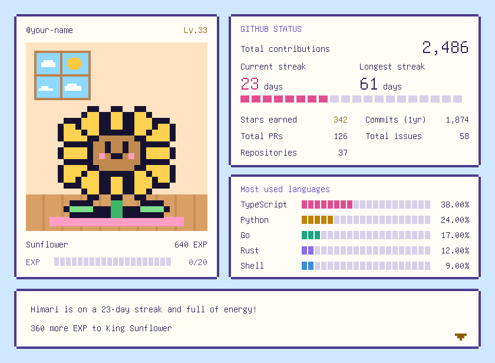
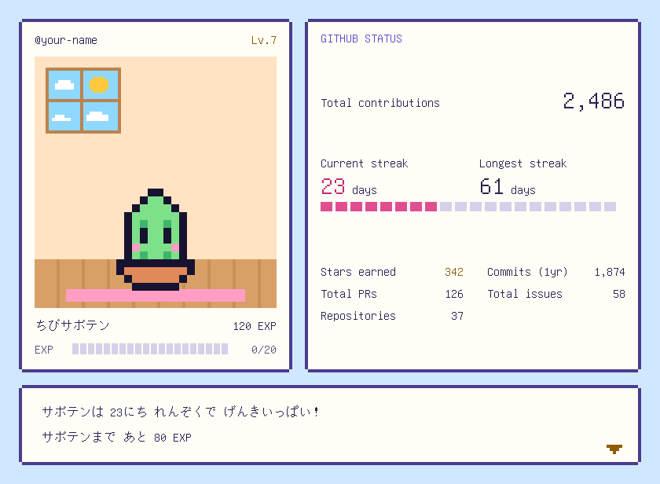
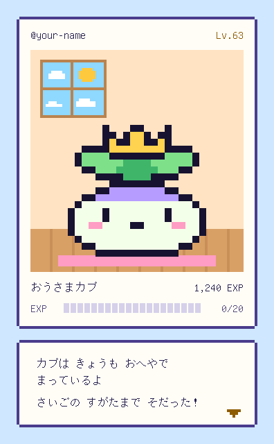

# ドットのおへや (Tiny Pixel Room)

日本語 | [English](README.en.md)

<picture>
  <source media="(prefers-reduced-motion: reduce) and (prefers-color-scheme: dark)" srcset="examples/samples/card-dark-still.svg">
  <source media="(prefers-reduced-motion: reduce)" srcset="examples/samples/card-light-still.svg">
  <source media="(prefers-color-scheme: dark)" srcset="examples/samples/card-dark.svg">
  
</picture>

GitHub プロフィールに、育つドット絵のおへやを飾る GitHub Action です。GitHub で活動するほど、おへやのキャラクターが育ちます。

- キャラクターはカブ、ヒマワリ、サボテンから選べます。どれも 5 段階に育ちます
- カードの言葉とキャラクターの名前は、日本語 (既定) か英語を選べます
- contributions、連続記録、よく使う言語、スター、過去 1 年のコミット、PR、Issue、リポジトリの数を表示します
- 見る人の GitHub やブラウザの設定に合わせて、昼のおへやと夜のおへやが切り替わります。いつも昼か夜にもできます
- 動きを減らす設定の人には、止まったカードを表示します

## サンプル

左から、英語のカード (`language: en`)、言語を隠したカード (`hide: langs`)、キャラクターだけのカード (`hide: all`) です。数字はすべて見本です。

<picture>
  <source media="(prefers-color-scheme: dark)" srcset="examples/samples/sunflower-en-dark.svg">
  
</picture>
<picture>
  <source media="(prefers-color-scheme: dark)" srcset="examples/samples/cactus-hide-langs-dark.svg">
  
</picture>
<picture>
  <source media="(prefers-color-scheme: dark)" srcset="examples/samples/character-only-dark.svg">
  
</picture>

## 使い方

[設定サイト](https://moppy626.github.io/tiny-pixel-room/)では、キャラクターや表示する項目を選びながらカードを試せて、その設定のワークフローを作れます。サイトの説明は、選んだカードの言葉 (日本語 / English) で表示します。英語のページは [https://moppy626.github.io/tiny-pixel-room/en/](https://moppy626.github.io/tiny-pixel-room/en/) です。

1. ユーザー名と同じ名前の公開リポジトリ (プロフィール用リポジトリ) を用意します。
2. そのリポジトリに `.github/workflows/tiny-pixel-room.yml` を作り、次の内容を貼ってコミットします。

   ```yaml
   name: ドットのおへや

   on:
     schedule:
       - cron: '17 15 * * *' # 毎日 00:17 (日本時間)
     workflow_dispatch:
     push:
       paths:
         - .github/workflows/tiny-pixel-room.yml

   permissions:
     contents: write

   concurrency:
     group: tiny-pixel-room

   jobs:
     card:
       runs-on: ubuntu-latest
       timeout-minutes: 10
       steps:
         - uses: actions/checkout@v7
         - uses: moppy626/tiny-pixel-room@v1
           with:
             character: turnip # turnip / sunflower / cactus
             pet-name: ''
             language: ja # ja (日本語) / en (英語)
   ```

3. Action が動くと、`tiny-pixel-room` フォルダにカードができます。以降は毎日 1 回更新されます。
4. プロフィール用リポジトリの `README.md` に、次の内容を貼ります。

   ```html
   <picture>
     <source media="(prefers-reduced-motion: reduce) and (prefers-color-scheme: dark)" srcset="tiny-pixel-room/card-dark-still.svg">
     <source media="(prefers-reduced-motion: reduce)" srcset="tiny-pixel-room/card-light-still.svg">
     <source media="(prefers-color-scheme: dark)" srcset="tiny-pixel-room/card-dark.svg">
     
   </picture>
   <br>
   <sub><a href="https://moppy626.github.io/tiny-pixel-room/">ドットのおへや</a></sub>
   ```

   カードの下には、設定サイトへの小さなリンクが付きます。要らなければ、`<br>` からあとの 2 行を消してください。

   見る人の GitHub やブラウザの設定に合わせて、昼のおへやと夜のおへやが切り替わります。いつも昼のおへやにするときは、かわりに次の内容を貼ります。いつも夜のおへやにするときは、2 か所の `light` を `dark` にします。

   ```html
   <picture>
     <source media="(prefers-reduced-motion: reduce)" srcset="tiny-pixel-room/card-light-still.svg">
     
   </picture>
   <br>
   <sub><a href="https://moppy626.github.io/tiny-pixel-room/">ドットのおへや</a></sub>
   ```

## 設定

`with:` に書ける項目です。すべて省略できます。

| 名前 | 既定値 | 説明 |
|---|---|---|
| `character` | `turnip` | `turnip` (カブ)、`sunflower` (ヒマワリ)、`cactus` (サボテン)。変えると成長はリセットされます |
| `pet-name` | 空 | キャラクターの名前。10 文字まで (超えた分は切り、警告を出します)。空なら `language` に合わせた種類名 (`カブ`、`Turnip` など) になります |
| `language` | `ja` | カードの言葉とキャラクターの名前。`ja` (日本語) か `en` (英語)。GITHUB STATUS の項目名はどちらも英語です。変えても成長はリセットされません |
| `hide` | 空 | 隠す項目をカンマ区切りで指定します (`contrib, langs` など)。書ける名前は[カードに出す項目](#カードに出す項目)にあります。残った項目は詰めて並べ、空いた分は枠の高さで調整します。`all` と書くとすべて隠し、キャラクターだけの細いカードになります。`all` なら、あとで項目が増えても細いカードのままです |
| `motion` | `true` | `false` にするとキャラクターが動かなくなります |
| `username` | リポジトリの持ち主 | カードに表示する GitHub ユーザー名 |
| `github-token` | `github.token` | GitHub API の読み取りに使うトークン。既定のままにしてください。自分で作ったトークンを渡す使い方はサポートしていません ([知っておいてほしいこと](#知っておいてほしいこと)) |
| `output-dir` | `tiny-pixel-room` | カードと状態ファイル (`state.json`) を置くフォルダ。途中で変えるときは、前のフォルダの `state.json` も移してください。移さないと今日から育て直しになります |
| `commit` | `true` | `false` にするとコミットしません。その場合は `state.json` を自分で保存しないと、毎回育て直しになります |

### カードに出す項目

カードの右側に出す項目と、`hide` に書く名前です。設定サイトでは、項目にマウスを重ねると、この説明が出ます。数字の細かい数え方は[カードの数字の数え方](#カードの数字の数え方)にあります。

| カードの項目 | `hide` に書く名前 | 説明 |
|---|---|---|
| Total contributions | `contrib` | プロフィールの草に出る contributions の、これまでの合計 |
| Current streak | `current` | contributions がある日が、今日まで続いている日数 |
| Longest streak | `longest` | contributions がある日が、これまでで一番長く続いた日数 |
| Most used languages | `langs` | 自分のリポジトリでよく使っている言語の上位 5 つと、その割合 |
| Stars earned | `stars` | 自分のリポジトリについたスターの合計 |
| Commits (1yr) | `commits` | 過去 1 年のコミットの数 |
| Total PRs | `prs` | 自分が作った PR の数 |
| Total issues | `issues` | 自分が作った Issue の数 |
| Repositories | `repos` | 自分のリポジトリの数 |

## カードの数字の数え方

[github-readme-stats](https://github.com/anuraghazra/github-readme-stats) と [GitHub Readme Streak Stats](https://github.com/DenverCoder1/github-readme-streak-stats) の既定の数え方に合わせています。

| 項目 | 数え方 |
|---|---|
| Total contributions | 草の contributions の、全期間の合計 |
| Current streak | 今日まで続いている、contributions がある日の連続日数。今日がまだ 0 件でも、昨日まで続いていれば切れません |
| Longest streak | 全期間で一番長く続いた連続日数 |
| Stars earned | 自分のリポジトリのスターの合計。フォークしたリポジトリも数えます |
| Commits (1yr) | 草に出ている期間 (およそ過去 1 年) のコミットの数 |
| Total PRs、Total issues | 自分が作った PR と Issue の数。開いているものも閉じたものも数えます |
| Repositories | 自分のリポジトリの数。フォークしたリポジトリも数えます |
| Most used languages | フォークを除いた自分のリポジトリの、言語ごとのコードの量 (バイト数)。多い順に 5 つ出し、割合はその 5 つの合計に対する値です |

非公開の活動をどこまで数えるかは、[非公開の活動の扱い](#非公開の活動の扱い)にあります。

## 非公開の活動の扱い

スター、コミット、PR、Issue、リポジトリの数、言語は、公開リポジトリの分だけを数えます。

## キャラクターの育ち方

Action を使い始めた日からの contributions で育ちます。1 contribution で 1 EXP、20 EXP ごとに Lv が上がります。

EXP はこれまでの最高値より下がりません。リポジトリを消したりして草の数が減っても、育った姿は戻りません。そのかわり、減った分を取り戻すまでは EXP は増えません。最高値は `state.json` に記録しています。

`character` を変えると、成長は 0 に戻り、次の日の contributions から育て直しになります。変えた日の contributions は EXP に入りません。元のキャラクターに戻しても、前の成長は引き継ぎません。`language` を変えても、成長はリセットされません。

GitHub のステータスはアカウント全体の値で、使い始めた日やキャラクターの変更には影響されません。

## 日付の区切り

連続記録、使い始めた日、キャラクターを変えた日は、GitHub の草と同じ日付で数えます。日付は UTC で区切るので、日本時間では朝 9 時に日付が変わります。

GitHub から届いた草の最後の日を今日として数えるので、草と数がずれません。

## 知っておいてほしいこと

- **数値が少なく見えるとき:** スターやコミットなどは、公開リポジトリの分だけを数えます ([非公開の活動の扱い](#非公開の活動の扱い))。
- **GitHub の調子が悪いとき:** 一時的なエラー (502 などのエラー、タイムアウト、API の回数の上限) は、間をあけて 2 回までやり直します。回数の上限では GitHub が示す時間だけ待ちますが、1 分より長く待つ必要があるときはやり直しません。それでも失敗した日はカードが更新されず、次の日の実行で更新されます。
- **名前に使えない文字:** 名前に使えるのは、日本語、英語、ハングル、中国語、アクセント付きのラテン文字、ギリシャ文字、キリル文字、アルメニア文字、ジョージア文字と、よく使う記号です。それ以外の文字 (アラビア文字、ヘブライ文字、タイ文字、インドの文字など) と、🌱 や ✨ のような絵文字は、名前から外れます。アクセントや ゜ のような記号を重ねた字は、é や ñ や ぱ のように 1 字の形があれば描きます。g̃ や か゚ のように 1 字の形がない字は、重ねた記号だけが外れます。漢字は、ふだん使う字 (CJK 統合漢字と拡張 A) はすべて描けます。それより後に加わった字 (拡張 B 以降) は、およそ 7 万字のうち 1,800 字ほどしかフォントにないので、𠮷 (つちよし) や 𥡴 のように名前で使う字でも、多くは外れます。外したときは Action の実行結果に警告が出ます。❤ や ★ のように字としても使う記号 (絵文字キーボードで入れた ❤️ も含みます) と、⭐︎ のように字として表示する指定の付いた記号は、白黒のドットの字で描きます。
- **`commit: false` にするとき:** 開始日と最高 EXP は `state.json` に記録しています。カードと一緒に `state.json` も保存しないと、実行のたびに育て直しになります。
- **`state.json` を消すと:** 開始日と最高 EXP がなくなり、今日から育て直しになります。`output-dir` を変えて、前のフォルダの `state.json` を移さなかったときも同じです。
- **トークンについて:** `github-token` は既定のままにしてください。自分で作ったトークンを渡す使い方はサポートしていません。Action に渡したトークンは Action のコードからそのまま使えるので、万一漏れたときは、そのトークンで読めるものがすべて読まれてしまいます。
- **既定のブランチ以外で動いたとき:** Web エディタで作ったブランチなど、既定のブランチ以外でワークフローが動いたときは、カードを更新しません。
- **更新が止まったとき:** リポジトリに 60 日間活動がないと、GitHub が毎日の実行を止めることがあります。リポジトリの Actions タブから有効にし直してください。
- **版を固定したいとき:** `@v1` は、新しい版を出すたびに付け替えるタグです。新しい版を自動で使わず、確かめてから更新したいときは、`@v1` のかわりにコミット SHA を書きます (`moppy626/tiny-pixel-room@<コミット SHA> # v1.0.0` など)。プロフィール用リポジトリに Dependabot (`package-ecosystem: github-actions`) を設定すると、新しい版が出たときに更新の PR が届きます。

## セキュリティ

脆弱性を見つけたときは、公開の Issue には書かず、[SECURITY.md](SECURITY.md) の手順で非公開で知らせてください。

## ライセンス

MIT License です。カードの文字は、[GNU Unifont JP](fonts/UNIFONT-LICENSE.txt) (日本語の字の形の GNU Unifont) の一部で描いています (SIL Open Font License 1.1)。`dist/index.js` に同梱しているソフトウェアのライセンスは [THIRD_PARTY_LICENSES.txt](THIRD_PARTY_LICENSES.txt) にあります。
